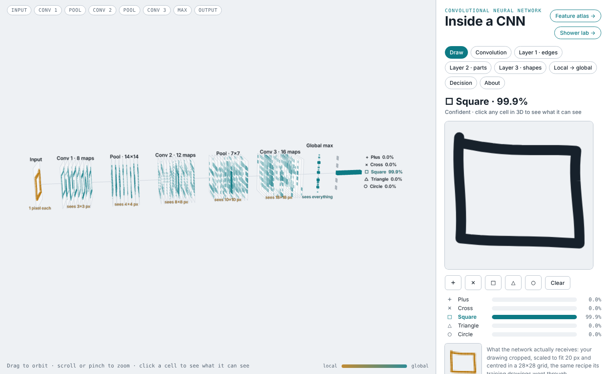
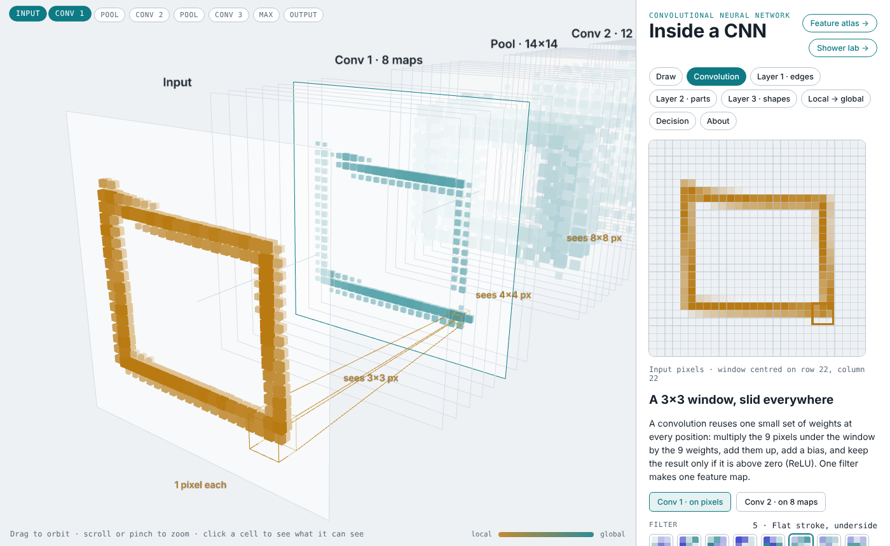
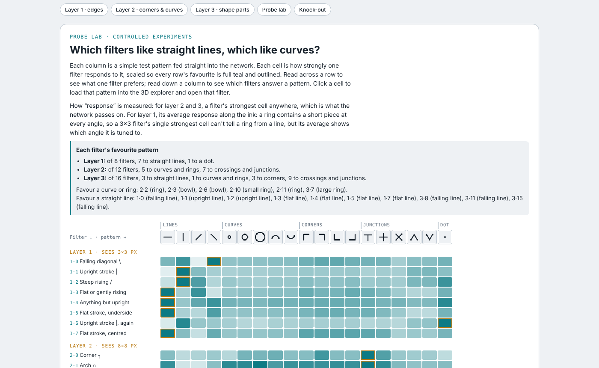
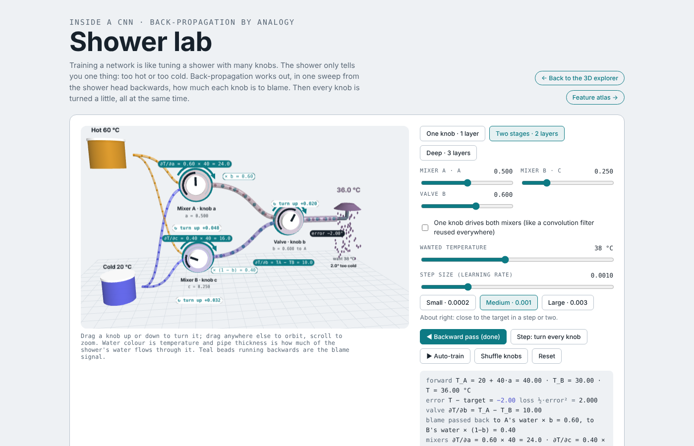
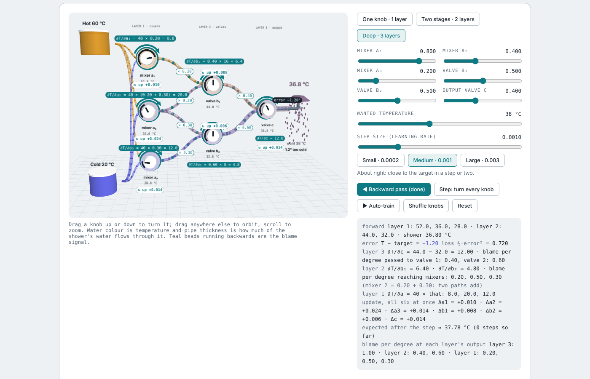

# Inside a CNN

### [▶ Launch the live demo](https://shanem73.github.io/cnn-model/)

[3D explorer](https://shanem73.github.io/cnn-model/) · [Feature atlas](https://shanem73.github.io/cnn-model/#atlas) · [Shower lab](https://shanem73.github.io/cnn-model/#shower)

An interactive 3D explorer of a small, **really trained** convolutional neural network. Draw a shape and watch every layer respond: a 3×3 window sliding over the pixels, edge detectors in layer 1, corners and curves in layer 2, whole shape parts in layer 3, and the vote that picks the answer.

It comes with two companion views for teaching: a **Feature atlas** that lays out what all 36 filters respond to, and a **Shower lab** that explains back-propagation with hot and cold water.




---

## What's inside

### 3D explorer (`index.html`)

| Stage | What you can do |
|---|---|
| **Draw** | Sketch a plus, cross, square, triangle or circle (or pick an example) and watch the signal travel through every layer. |
| **Convolution** | Sweep a 3×3 filter over the image and read the arithmetic at every position: pixels × weights, sum, bias, ReLU. A second mode shows a 3×3×8 layer-2 filter adding up 72 products. |
| **Layer 1 · edges** | For each filter: its weights, its orientation tuning curve, its map on your drawing, its 8 strongest test patches and which shapes they came from. |
| **Layer 2 · parts** | The same views for corner, curve and junction detectors (each cell sees 8×8 px). |
| **Layer 3 · shapes** | The same views for shape-part detectors (each cell sees 18×18 px). |
| **Local → global** | Click any cell to see its receptive field as a cone back to the input. Measured probes show how much each layer knows (61% → 82% → 100%). |
| **Decision** | See each layer-3 channel's vote for each shape, and where in your drawing it found its best match. |



### Feature atlas (`index.html#atlas`)

All 36 convolution filters side by side, grouped by layer:

- **Typical input** (mean of the 50 strongest test patches) and a **synthesised input** (gradient ascent) for every filter.
- **Probe lab:** every filter against 19 test patterns (lines at four angles, small to large rings, arches, corners, crossings). It answers "which filters like straight lines, which like curves?" and loads any pattern into the 3D view.
- **Knock-out experiment:** switch filters off and watch the prediction change, plus the measured accuracy loss for each filter. Losing any one layer-1 or layer-2 filter costs at most a few percent; losing filter 3·3 drops triangles to 0%.
- **What the network "imagines":** inputs that maximise each class score.



### Shower lab (`index.html#shower`)

Back-propagation explained with a shower. The shower only tells you "too hot" or "too cold"; the backward pass works out how much each knob is to blame, then every knob is turned a little at the same time.

The plumbing is a 3D scene: glass pipes with water flowing through them, coloured by temperature and sized by how much of the shower's water each one carries. Drag a knob up or down to turn it, drag anywhere else to orbit. During the backward pass, teal beads run backwards through the pipes and each stage's chain-rule product floats beside it. Sliders in the panel give exact control of every knob.

- **One knob**, **two stages**, and a **deep three-layer** shower (3 mixers → 2 valves → 1 output valve), with the blame shown travelling back stage by stage and every chain-rule product written out.
- Ten experiments: the worked example, blame shrinking through stages, a shut valve (a ReLU at zero), learning rate too large, shared knobs (convolution weight sharing), blame adding where paths meet, vanishing gradients, and many equally good solutions.





---

## The model

A small network trained from scratch for this project with plain NumPy:

```
28×28 input → conv 3×3 (8) → max-pool 2 → conv 3×3 (12) → max-pool 2 → conv 3×3 (16) → global max → 5 scores
```

- **2,785 trained weights.** Trained on 11,000 synthetic hand-drawn shapes (wobbly strokes, random size, aspect, rotation up to ±18°, stroke width, gaps) and tested on 1,500 it never saw: 100% correct.
- **Every number in the page is computed live** in the browser from the trained weights.
- **Two choices for readability.** Layer-1 filters are kept summing to zero, so they act as edge detectors rather than ink detectors. Global max pooling after layer 3 means every vote can be traced to one 18×18 window in the image.
- **Honest limits.** The task is easy: drawings are centred and scaled first, so even a linear model on raw pixels does well. The point is to watch how a CNN builds its answer. The network only knows five shapes, so anything else is forced into one of them. Filter names were written by hand from the computed views.

---

## Run it locally

It's a single static page.

```bash
git clone https://github.com/ShaneM73/cnn-model.git
cd cnn-model
python3 -m http.server 8000
# open http://localhost:8000
```

three.js (r128) and its OrbitControls ship in `vendor/`, so the page doesn't depend on a CDN for them; public CDNs are only used as a fallback. The fonts load from Google Fonts and fall back to system fonts offline.

### Editing the page

```
src/template.html   page structure and styles
src/app.js          network, 3D scene, atlas, shower lab and controls
src/build.py        assembles index.html from the sources and training/*.json
```

After editing, rebuild:

```bash
python3 src/build.py
```

### Retraining the model

Needs Python 3 with NumPy and Pillow. Run from the repository root:

```bash
python3 training/data.py      # generate 12,500 synthetic drawings (training/data.npz, not committed)
python3 training/train.py     # train the CNN → training/params.npz
python3 training/analyze.py   # top patches, class shares, probes, weights → training/model.json
python3 training/tuning.py    # layer-1 orientation tuning → training/tuning.npy
python3 training/names.py     # add the hand-written channel names → training/model.json
python3 training/featvis.py   # synthesised inputs, typical inputs, knock-outs → training/featvis.json
python3 src/build.py
```

The seeds are fixed, so the steps reproduce the committed `model.json`. If you retrain with different settings, the channels will change and the names in `names.py` need rewriting.

---

## Publishing

The live site is served by GitHub Pages from the `gh-pages` branch:

```bash
python3 src/build.py
git commit -am "Update page"
git push origin main
git push origin main:gh-pages
```

---

## Project structure

```
index.html              the built page (explorer + atlas + shower lab)
src/                    sources used to build index.html
vendor/                 three.js r128 and OrbitControls (MIT, © three.js authors)
training/               data generator, NumPy training and analysis scripts, trained weights
docs/screenshots/       images for this README
.nojekyll               serve files as-is on GitHub Pages
```

## Credits

- Visual style follows [Inside AlphaZero](https://github.com/ShaneM73/inside-alphazero).
- Feature visualisation ideas from M. Zeiler and R. Fergus, "Visualizing and Understanding Convolutional Networks" (ECCV 2014), and C. Olah et al., "Feature Visualization" (Distill, 2017).
- Built with [three.js](https://threejs.org/) (MIT), included in `vendor/`.

## License

MIT. See [LICENSE](LICENSE).
